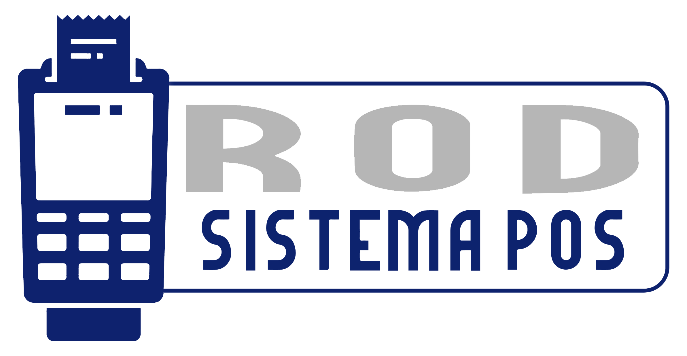

# ROD POS

<p align="center">
  
</p>

<p align="center"><strong>Sistema POS local para ventas, stock, administración y emisión ARCA (AFIP).</strong></p>

<p align="center">
  
  
  
  
  
  
  
</p>

---

## Manuales

- Manual simple de uso diario: `MANUAL_CLIENTE.md`
- Manual tecnico (instalacion, ARCA y soporte): `MANUAL_TECNICO.md`

---

## Que hace el sistema

ROD POS esta pensado para correr en comercios chicos/medianos, sin servidor externo:

- Venta por codigo de barras y carga manual de articulos.
- Control de stock automatico.
- Arqueo de caja y reportes.
- Gestion de usuarios (vendedor/admin).
- Licencia por HWID.
- Emision fiscal ARCA con cola de pendientes y reintento.
- Generacion de ticket PDF para impresora termica 58mm.

---

## Estructura basica

- `main.py`: inicio de app y acceso a paneles.
- `ui/`: interfaces (login, ventas, admin, stock, pendientes ARCA).
- `db_init.py`: creacion/migracion de base local.
- `fiscal_service.py`: integracion WSAA/WSFE (ARCA) + manejo de errores.
- `dist/RodPOS.exe`: ejecutable para entrega (al compilar).

---

## Requisitos para desarrollo

- Windows 10/11
- Python 3.10+ (recomendado usar `py`)

Instalacion de dependencias:

```bash
py -m pip install pillow fpdf2 qrcode pyinstaller
py -m pip install "git+https://github.com/reingart/pyafipws.git"
```

---

## Ejecutar en modo desarrollo

```bash
py main.py
```

---

## Compilar a EXE

```bash
py -m PyInstaller RodPOS.spec
```

Resultado:

- `dist/RodPOS.exe`

Para entregar al cliente:

- `dist/RodPOS.exe`
- carpeta `dist/db` (si queres una base inicial)
- archivos de licencia/certificados segun el caso

---

## Flujo operativo (resumen)

1. Ingresar con usuario vendedor o admin.
2. En ventas, cargar productos y confirmar pago.
3. El sistema guarda venta + detalle + actualiza stock.
4. Si se solicita comprobante fiscal:
   - intenta emitir en ARCA,
   - si falla, guarda en pendientes para reintento.
5. Se genera ticket PDF y opcion de impresion.

---

## Como conectarlo con ARCA (paso a paso)

### 1) Preparar certificado productivo

Necesitas en la PC del comercio:

- archivo `.crt` (certificado)
- archivo `.key` (clave privada)

> Si tenes `.pfx`, primero exportalo a `.crt` y `.key`.

### 2) Configurar punto de venta en ARCA

En el ABM de ARCA/AFIP:

- habilita el punto de venta para Factura Electronica
- usa ese mismo numero en el sistema (`arca_punto_venta`)

### 3) Cargar datos en el panel Admin -> ARCA/Ticket

Completar como minimo:

- Razon social
- CUIT empresa
- IIBB
- Punto de venta
- Ambiente: `produccion`
- CUIT representada ARCA
- Ruta certificado CRT (absoluta)
- Ruta clave KEY (absoluta)

Ejemplo de ruta Windows:

- `C:\Certificados\empresa.crt`
- `C:\Certificados\empresa.key`

### 4) Validar ambiente correcto

- Produccion:
  - `https://servicios1.afip.gov.ar/wsfev1/service.asmx?WSDL`
  - `https://wsaa.afip.gov.ar/ws/services/LoginCms?WSDL`
- Homologacion:
  - `https://wswhomo.afip.gov.ar/wsfev1/service.asmx?WSDL`
  - `https://wsaahomo.afip.gov.ar/ws/services/LoginCms?WSDL`

Si tu certificado es de produccion, el ambiente debe ser `produccion`.

### 5) Probar una venta con Factura B

Al cobrar:

- elegir emision fiscal
- tipo `B`
- verificar que devuelva CAE

Si falla, revisar:

- panel de pendientes ARCA
- archivo `debug_afip.txt` junto al exe

---

## Solucion de problemas ARCA

- **Error XML / `junk after document element`**:
  - borrar carpeta `cache_arca` junto al exe
  - reintentar emision
- **Sin CAE**:
  - validar certificado, punto de venta y ambiente
- **No imprime**:
  - revisar impresora predeterminada Windows
  - probar abrir el PDF manualmente

---

## Licencia

Uso privado/comercial del titular del sistema. Ajustar terminos segun tu distribucion.
